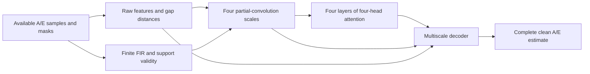

# Full-stream gaps with IMR signals and link-propagated TDI availability

Current expanded experiments are described in [LONGRUN.md](LONGRUN.md).
That document specifies the 8192/512-source bank, two higher-resolution models,
targeted augmentation and bounded training campaign. The original pilot below
remains a historical validation reference.

This package implements a new experimental protocol on branch
`physical-gaps-tdi-imr`. The baseline commit is `dbda45a`.
Historical `prd_physical` results and the Overleaf manuscript retain their own
observation model and provenance. This package supplies a separately evaluated
method for **d = G(s+n)**, with G equal to one on available samples.

## Physical problem and current implementation

The clean target s is the complete second-generation Michelson A/E response of
an IMRPhenomTHM binary-black-hole waveform. The observation contains both signal
and noise on available samples and exactly zero on missing samples. A and E
carry separate binary masks. The output estimates the clean signal throughout
the record, including denoising outside gaps.

The simulator uses detector-frame component masses M_source(1+z), luminosity
distance from FlatLambdaCDM(H0=67.4, Om0=0.315), isotropic orientations, source
total masses 1e5--5e6 solar masses, q=m_light/m_heavy in [0.3,1], redshift [1,6],
and nonspinning progenitors. The first protocol retains this population to
isolate the observation and waveform changes. Spins and independent waveform
families enter the validation extension described below.

Records contain 32768 samples at 2 Hz (16384 seconds), with 2048 seconds of
padding on each side before the LISA response. The source polarization-envelope
peak is jittered between 1024 and 3072 seconds inside the record. Temporal
coverage is checked against six estimated 220 damping times plus a response
guard. The 33--53 second **link** outages in the pilot retain an absolute-time
connection to the previous experiments. Their propagated output durations and
fractions are stored explicitly. Fractions from older 528-second records refer
to that earlier protocol.

### Pau point 2: propagate availability through the TDI operator

`masks.py` reads the actual X-term arrays passed to the installed response
backend and constructs the cyclic Y/Z terms. Each term requires its directed
link at the sum of the delays. The current implementation assumes equal-arm
orbits, L/c = 2.5e9/c seconds. It uses a conservative order+2-sample interpolation
guard, then combines required samples by logical intersection. A=(Z-X)/sqrt(2)
requires X and Z; E=(X-2Y+Z)/sqrt(6) requires X, Y and Z.

The mask is tested against the actual numerical TDI operator by replacing all
missing link samples with arbitrary large values. Every retained A/E sample
must be unchanged. `diagnostics.py` exercises all six individual links and a
simultaneous six-link outage, each at 0.5 and 33 seconds. It also constructs a
larger guard mask for a paired sensitivity test of nearby delayed information.
The larger mask is an explicit stress condition; the resulting change in
reconstruction accuracy quantifies the reliance on that information.

Complete A/E secondary noise is drawn from the stationary equal-arm scirdv1 PSD
and receives the propagated availability mask. On retained samples this is the
complete-output observation restricted to valid data. The current simulator
omits raw laser noise, foregrounds and time-varying arms. Extension to raw
interferometric/telemetry streams requires those noise transfer functions and
their gap propagation to be implemented together. The present scope is a
stationary secondary-noise experiment with physically propagated availability.

### Pau point 3: physical prehistory and the QNM fitting domain

`physics.py` generates inspiral, merger and ringdown through IMRPhenomTHM.
The source starts sufficiently early to supply the entire response support.
The orbital phase is referenced at f_ref=0.02/(G M_detector/c^3), independently
of the waveform start frequency. Sub-sample envelope-peak alignment and cubic
source resampling make changes of padding converge at fixed source parameters.
Late zero extension is accepted only below 1e-5 of the peak strain amplitude.
The artificial exponential pre-reference ringup used by the earlier generator
is absent from this path. Remnant fits provide an estimated f220 and tau220 for
coverage and evaluation windows; the full IMR signal supplies the target.

The primary output is the neural A/E reconstruction. A later conditional QNM
analysis must specify its source reference time and restrict its fitting domain
to the post-merger regime. Proposed controls are t_start=10,20,40 remnant M after
the dominant-mode peak and an independently generated IMR family. A projected
QNM basis must have valid source history throughout each fitted TDI term and
interpolation stencil. Whitening support adds its own guard. A cut applied only
after global FFT whitening mixes earlier times into the fit; use the selected
time-domain covariance or a verified finite-support filter instead.

The source polarization peak stored here is a window-localization convention.
A QNM validity study additionally needs the dominant-mode peak and a scan of
fit stability. Conditional fits at injected parameters remain a diagnostic of
basis consistency. Operational parameter uncertainty is assessed with parameters
estimated from available data, or independently specified perturbations. These
conditional-fit experiments remain an acceptance gate before reporting their
performance for this new protocol.

## Gap handling and the new network

Independent complete noise records calibrate the finite-record PSD and channel
RMS. The input has ten features: raw available A/E, finite-FIR-filtered A/E,
the two observation masks, the two FIR-support masks, and signed distances to
gap boundaries. Raw features preserve observations immediately beside a gap.
Filtered features are supplied only where the whole FIR stencil is observed;
other locations carry zero plus an explicit invalidity mask. PSD inverse gain
is regularized at 1e-4 of the channel median and the 65-tap filter uses a Kaiser
window. Its finite support makes this an approximate whitening feature.
Noise-only calibration, support-loss and floor/filter-length sensitivity must
be measured at production scale.

The encoder consists of four mask-normalized partial-convolution stages with
widths 24,48,96,128 and stride 4. The bottleneck has four standard Transformer
encoder layers, four attention heads, positional encoding and feed-forward
width 512. Invalid tokens are excluded as attention keys. Missing query tokens
use the remaining context. A multiscale decoder combines skip features and the
raw inputs to predict two complete clean channels. The model has 1,121,938
parameters. Tests check nonzero Q, K and V projection gradients in every layer.
This architecture is trained from fresh weights.



Training combines log(1+normalized error) terms for the complete time record,
the missing samples and the PSD-weighted spectrum. An additional detector-peak
to six-tau window term gives merger/ringdown errors weight within the long IMR
record. Logarithmic robustification bounds the influence of very weak sources;
all generated sources remain in the dataset. The spectral loss is a supervised
waveform distance. AdamW, gradient clipping, validation-driven learning-rate
reduction, early stopping and atomic resumable checkpoints are implemented.
Only training and validation directories are accessible to the training loader.

## Spectral leakage and covariance

For a stationary complete noise covariance C and an observed-sample selector P,
the measured noise covariance is C_OO=P C P^T. On a zero-filled full grid it is
G C G. Fourier transformation gives F G C G F^H, which generally has offdiagonal
terms. `covariance.py` implements a dense marginal-covariance reference for at
most 2048 retained samples. A noise Monte Carlo checks the expected quadratic
form against the number of retained degrees of freedom. A larger operational
likelihood would use a separately validated Toeplitz matrix-vector/CG solver.

`edge_taper` supplies a half-cosine baseline. Tapering reduces sharp-edge leakage
while modifying exposure and covariance. The baseline, raw-gap branch and
finite-support feature branch are evaluated as paired conditions. The main
input preserves near-edge observations in its raw branch. No unobserved value
is read by preprocessing; replacing hidden values with NaNs leaves features
unchanged.

The complete reconstructed waveform is evaluated with direct joint A/E PSD
overlap, at fixed time and phase. The metric uses the frozen independent-noise
periodogram PSD, a declared median-relative floor, excludes DC, and half-weights
the real Nyquist bin. The periodogram itself doubles interior bins only. These
conventions also determine the noise RMS through Parseval's identity.

Both full-record and detector-peak-to-six-tau mismatch are reported. The latter
uses the same frozen PSD interpolated onto the cropped frequency grid. It is
a prescribed waveform comparison; the exact finite-crop likelihood has its own
covariance. Production validation must compare PSD floors, crop windows and
noise-calibrated short-window spectra. A source's physical parameters define
synthetic evaluation windows and never enter the model inputs.

## Experimental progression

1. Operator and statistics tests: observation algebra, missing-value invariance,
   TDI replacement tests, FIR support, covariance normalization, active attention
   gradients, waveform coverage and padding convergence.
2. Pilot: source-disjoint training/validation, fresh weights, baseline comparisons,
   paired gap variants, and optimization stability. The first 128/32-source run
   validates the executable pipeline and exposes the remaining recovery error.
3. Expanded pilot: at least 2048/256 sources; fresh noise and gaps per training
   source; fixed validation realizations; source-level separation of every
   augmentation. Evaluate plain post-TDI, propagated-link and extended-guard
   masks on the same sources. Compare raw-only, finite-FIR and tapered inputs.
   Add 100--300-second gaps and random multi-interval patterns as explicit stress
   subsets. Implement these augmentation/ablation switches before that run.
4. Production gates: stabilize gap-local recovery, verify alternative waveform
   family and padding/frequency convergence, inspect SNR-stratified errors, and
   freeze protocol/model selection before generating the independent test set.
   Report all sources and predefined subsets; gap-local amplitude error and
   noise-covariance residuals complement normalized waveform similarity.
5. A separate post-merger QNM study evaluates parameter uncertainty, reference-time
   scans and physical-basis mismatch. Manuscript numerical replacements follow
   these independent tests.

The new pilot and the earlier 0.00537 result use different waveform, observation,
duration and evaluation conditions. A quantitative improvement claim requires a
paired benchmark under the same new protocol.

## Commands

Run from the repository root with the existing `gw_ml_env` Python environment.

```bash
PYTHONDONTWRITEBYTECODE=1 python -m prd_gaps.verify --output /tmp/gaps_verify.json
PYTHONDONTWRITEBYTECODE=1 python -m prd_gaps.diagnostics --output /tmp/gaps_covariance.json
PYTHONDONTWRITEBYTECODE=1 python -m prd_gaps.generate --output outputs/physical_gaps_pilot --train 128 --val 32 --calibration 256
PYTHONDONTWRITEBYTECODE=1 python -m prd_gaps.train --data outputs/physical_gaps_pilot --output outputs/physical_gaps_training --epochs 60 --patience 12 --batch-size 4
PYTHONDONTWRITEBYTECODE=1 python -m prd_gaps.evaluate_pilot --data outputs/physical_gaps_pilot --checkpoint outputs/physical_gaps_training/best.pt --output /tmp/gaps_validation.json
```

Resume with the same data/output paths, `--resume`, and a larger epoch budget.
The checkpoint verifies the manifest hash and the loader verifies every stored
record hash. Dataset manifests and training configs retain source-code hashes.
Pilot reports in `reports/` contain no independent-test claim.

## Primary sources

- Burke et al., *Mind the Gap: Addressing Data Gaps and Assessing Noise Mismodeling
  in LISA*: https://ntrs.nasa.gov/citations/20250002040
- Burke, Muratore and Woan, *The impact of missing data on the construction of
  LISA Time Delay Interferometry Michelson variables*: https://arxiv.org/abs/2510.06406
- Estelles et al., *Time-domain phenomenological model of gravitational-wave
  subdominant harmonics for quasicircular nonprecessing binary black hole
  coalescences*, Phys. Rev. D 105, 084039 (2022):
  https://doi.org/10.1103/PhysRevD.105.084039
- Response implementation and interpolation conventions:
  https://github.com/mikekatz04/lisa-on-gpu

Local backend adapters account for two installed-library interface defects
without editing the shared installation: the TDI term setter omits its backing
property, and the explicit-link argument checks a removed attribute. The tests
exercise the same backend buffers and term arrays used for normal projections.
